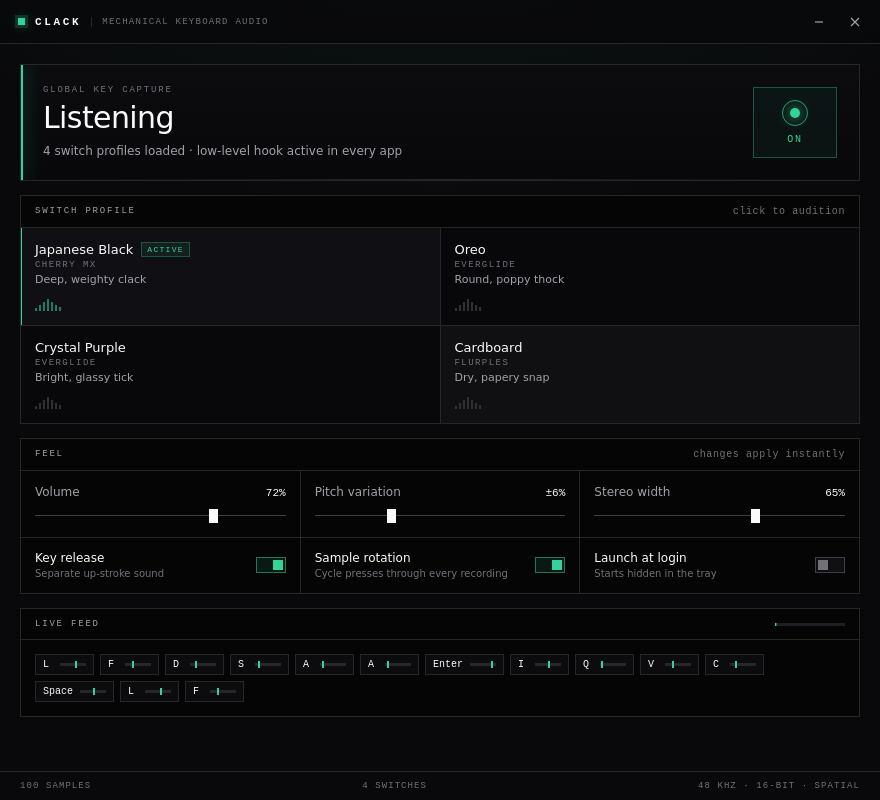

# Clack

Mechanical keyboard sounds for Windows — a native-feeling tray app that makes every keystroke sound like a real switch, in any application.

Built as a Windows equivalent of [Klack](https://tryklack.com) from its observable behaviour and its sample packs.



## What it does

- **Global key capture** — a low-level Windows keyboard hook (`uiohook-napi`), so typing in any app is heard. No admin rights, no window focus required.
- **Real switch samples** — 100 recorded WAVs across four switches, 48 kHz / 16-bit stereo, separate down-stroke and up-stroke takes.
- **Spatial audio** — every key is panned by its physical position on the keyboard; a short synthetic room reverb puts the clack in a space instead of on a dry bus.
- **Pitch variation** — ±0–20 % playback-rate jitter so repeated presses never sound identical.
- **Sample rotation** — successive presses cycle through every take of the selected switch instead of replaying one file.
- **Instant feedback** — buffers are decoded once at startup; a keystroke only allocates one playback node (~1 ms), and background throttling is disabled so the hidden tray window never sleeps.
- **Tray-first**, per-key stereo meter, live key feed, launch at login.

## Switches

| Profile | Brand | Character |
| --- | --- | --- |
| Japanese Black | Cherry MX | Deep, weighty clack |
| Oreo | Everglide | Round, poppy thock |
| Crystal Purple | Everglide | Bright, glassy tick |
| Cardboard | Flurples | Dry, papery snap |

## Run it

Requires Node 20+.

```bash
npm install
npm run dev      # Vite + Electron with hot reload
npm start        # production renderer, real app
```

## Build the installer

```bash
npm run dist         # NSIS installer for x64 + arm64 -> release/
npm run dist:dir     # unpacked app, no installer
```

Windows builds also run in CI (`.github/workflows/build-windows.yml`): every push to `main` produces a downloadable installer artifact.

## Cut a release

Installer builds and publishing are automated:

1. Bump `version` in `package.json` (for example `1.0.1`), then add the same version and its changes to `src/changelog.ts` — the in-app Versions panel reads that file.
2. Commit and push to `main`.
3. Tag and push: `git tag -a v1.0.1 -m "Clack 1.0.1" && git push origin v1.0.1`.

The tag build produces three files and publishes them onto the matching GitHub release, creating it or filling in an existing draft:

| Asset | Use |
| --- | --- |
| `Clack-<version>-setup.exe` | Combined x64 + arm64 installer — the normal download |
| `Clack-<version>-x64-setup.exe` | x64-only installer |
| `Clack-<version>-arm64-setup.exe` | Windows-on-ARM installer |

Manual route, if you'd rather not tag: run `npm run dist` on a Windows machine, open the draft release, attach the `release/*.exe` files, then press **Publish release**.

Installers are unsigned, so Windows SmartScreen shows *Windows protected your PC* — choose **More info → Run anyway**. Users of the private repo must be signed in to GitHub to download release assets.

> Packaging a Windows installer works from Linux/macOS only with [wine](https://electron.build/multi-platform-build) present, because the exe icon and version resources are patched with rcedit. The GitHub Actions workflow runs on `windows-latest`, where this is native.

## Using it

- The window is the settings panel. The title bar has three actions: **minimize** (normal taskbar button), **hide to tray** (removes the taskbar button), and **quit**.
- Left-click the tray icon to reopen settings; right-click for Open Clack, Minimize to taskbar, Hide to tray, quick switch, volume, pause and quit.
- The **Versions** panel lists every release; pick one to read its changes. The build you are running is tagged `RUNNING`.
- **Key release** adds the up-stroke sample (slightly quieter, like a real board).
- **Sample rotation** off replays one take per switch, on cycles through all takes.
- **Stereo width** 0 % is mono, 100 % spreads the keyboard fully left-to-right.

## How it is put together

```
electron/main.cjs      tray app, settings store, Windows key hook, IPC
electron/preload.cjs   contextBridge API (no node in the renderer)
src/audio.ts           Web Audio engine: decode, pan, reverb, pitch, limiter
src/keymap.ts          uiohook keycode -> keyboard position / label
src/App.tsx            settings UI + live feed
sounds/<switch>/       <keycode>-down.wav, <keycode>-up.wav
scripts/gen-icons.mjs  generates build/icon.png and build/tray.png
```

Audio path: `buffer -> gain -> stereo panner -> (dry + convolver) -> master -> limiter -> output`.

Keystrokes travel: OS hook (main) → IPC → renderer audio graph. Everything is pre-decoded, and the window is kept unthrottled while hidden, so the delay is one IPC hop.

## Notes and limits

- Sample packs are the vendor's recordings, kept for a personal, non-commercial reimplementation. See `NOTES.md` for the reverse-engineering evidence and what is inferred rather than observed.
- macOS is not a target; the reference app is native Swift and was not ported.
- The build was validated on Linux (renderer, packaging, audio graph) and in CI on Windows; see `NOTES.md` for exactly what was and was not executed.
